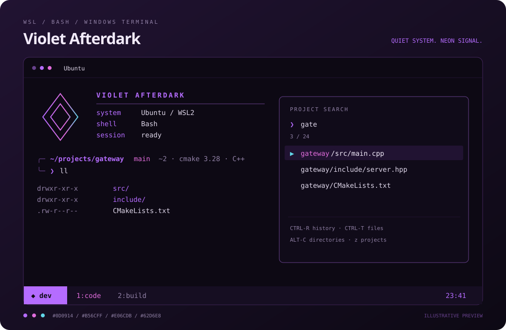

# Violet Afterdark

A dark, purple cyberpunk terminal for Ubuntu on WSL2. Bash stays Bash; Starship,
Windows Terminal, fastfetch, fzf, eza, bat, tmux, and VS Code share one palette.



For the Mac mini, see the [macOS setup](macos/README.md). It shares the prompt,
palette, tmux theme, and VS Code package, with a separate Zsh setup and Brewfile.

## Install

Prerequisites: Ubuntu on WSL2, Python 3.11+, Git, and Windows Terminal.
Pinned tool downloads target Linux x86_64. Existing binaries are retained.

```bash
git clone https://github.com/berggrenmille/wsl-rice.git
cd wsl-rice
python3 scripts/install-tools.py
export PATH="$HOME/.local/bin:$PATH"
python3 scripts/install.py preview --windows
python3 scripts/install.py apply --windows
```

Open a fresh Ubuntu tab. Use **0xProto Nerd Font Mono**, size 11. Install
[0xProto from Nerd Fonts](https://www.nerdfonts.com/font-downloads) on Windows
first if it is not already installed. Linux font installation does not install
the font for Windows Terminal. The font is not bundled in this repo.

`--windows` finds the stable Windows Terminal settings and merges the visible
profile whose name matches `$WSL_DISTRO_NAME`. Other profiles and the default
profile are preserved. JSONC comments are removed when the settings file is
serialized; the original bytes are backed up. To select an alternate installation
or profile, use `--windows-settings /mnt/c/.../settings.json --profile-guid '{...}'`.
Omit `--windows` for Linux configuration only.

Optional tmux requires `sudo apt install tmux` if it is not already installed.
Run `tmux` when you want sessions and panes; it is never launched automatically.
The GitHub CLI is optional: `python3 scripts/install-tools.py --with-gh`.

## Daily use

| Action | Key or command |
|---|---|
| Search shell history | `Ctrl-r` |
| Find a file and insert its path | `Ctrl-t` |
| Toggle file preview in that picker | `Ctrl-/` |
| Find a subdirectory | `Alt-c` |
| Jump to a frequently used project | `z project-name` |
| Choose among remembered directories | `zi` |
| Detailed file listing | `ll` |
| Two-level directory tree | `lt` |
| Syntax-highlighted file preview | `bat file.cpp` |
| Show the greeting again | `fastfetch` |
| Start or reattach the dev tmux session | `t` (or `tmux new -As dev`) |
| tmux shortcut menu | `Ctrl-b`, then `F1` |
| tmux split side by side (vertical divider) | `Ctrl-b`, then `v` |
| tmux split top/bottom (horizontal divider) | `Ctrl-b`, then `h` |
| Move between tmux panes | `Ctrl-b`, then an arrow key, or click a pane |
| Toggle current pane full-screen | `Ctrl-b`, then `z` |
| Overview of sessions, windows, and panes | `Ctrl-b`, then `w` |
| Cycle pane arrangement | `Ctrl-b`, then `Space` |
| tmux new window / next window / detach | `Ctrl-b`, then `c` / `n` / `d` |
| Reload tmux theme | `Ctrl-b`, then `r` |

For every tmux shortcut, press **Ctrl-b**, release both keys, then press the
second key. The `v` and `h` shortcuts work without AltGr on a Swedish layout.
The original `|` and `-` split shortcuts also work. In the F1 menu, press the
letter shown next to an action, or use the mouse; Escape dismisses it.
If you get lost, `Ctrl-b`, then `w` opens the overview: use arrows and Enter to
pick a window or pane, or Escape to cancel. `Ctrl-b`, then `z` enlarges the active
pane without closing any others; repeat to restore the layout.

While inside tmux, just continue working. After detaching or reopening the
terminal, `t` reconnects to the existing `dev` session, creating it only when
needed. Running `t` inside tmux prints a reminder instead of nesting a session.
Sessions survive terminal disconnection while the WSL instance stays running;
they do not survive a Windows reboot or `wsl --shutdown`.

The prompt shows directory, branch, changes, and development context. Native
Starship modules detect CMake, .NET, Node, Python, and Rust; C++ gets a lightweight
label. Context is based on the current directory's markers, rather than a
recursive repository scan. Commands over one second show their duration; failures
show their exit code. Everything is on the left, compatible with regular Bash.

The default NVM Node version is put on PATH immediately, so globally installed
commands such as Codex work in a fresh tab. NVM itself loads on the first `nvm`,
`node`, `npm`, `npx`, `corepack`, `yarn`, or `pnpm` command. Subsequent commands use
the real binaries/functions. Nested shells keep an already-selected version;
unusual unresolved aliases fall back to normal eager NVM initialization.
If a workflow needs
NVM initialized immediately, add `. "$NVM_DIR/nvm.sh"` to your local overrides.
Existing `.profile`, `.bash_aliases`, Rust setup, and the guarded `/opt/gcc-15.2`
toolchain integration are preserved. No toolchain is installed by this repo.

## VS Code extension

The theme-only extension source lives in `vscode/violet-afterdark/`. The ready-to-install
package is [dist/violet-afterdark-0.2.0.vsix](dist/violet-afterdark-0.2.0.vsix).
In Windows VS Code, run **Extensions: Install from VSIX…** in the Command Palette,
select the package, then choose **Violet Afterdark** or **Violet AfterLight** using
**Preferences: Color Theme** (**Ctrl-K**, release, then **Ctrl-T**).
AfterLight uses pale lavender surfaces, deep purple accents, dark plum text,
and a light terminal. Both themes are included in the same extension.
For a WSL workspace, install the theme on the Windows side (its extension kind is UI).
It changes colors only; your extensions, fonts, shortcuts, and terminal profile remain your choice.

To select the installed theme from WSL with a backup of your VS Code settings:

```bash
python3 scripts/vscode.py preview --terminal-font '0xProto Nerd Font Mono'
python3 scripts/vscode.py apply --terminal-font '0xProto Nerd Font Mono'
# Or select the light theme:
python3 scripts/vscode.py apply --theme 'Violet AfterLight'
```

The optional font argument matches the WSL terminal font. Omit it to keep the
current terminal font. Your editor font and icon theme are preserved. The script
targets stable Windows VS Code's default user settings. Use `--settings PATH`
for Insiders or a named VS Code profile. It parses JSONC and backs up the original
bytes before serializing JSON; comments are retained in the backup.

`python3 scripts/vscode.py restore` restores that settings backup separately from
the shell backups. Alternatively, simply choose your previous theme in the picker.
The VSIX remains installed until removed through Extensions.

Build a new package with Node.js 22+:

```bash
cd vscode/violet-afterdark
npm ci --ignore-scripts
npm run package
```

The pinned packager is a development dependency; the VSIX contains only theme
data and documentation. It is stored in the private repo, not published to the Marketplace.
The extension stays in this repo because it shares the terminal theme's palette
and maintenance. Its own package manifest and lockfile keep it independently
buildable if it moves to a dedicated repository later.
Official references: [color themes](https://code.visualstudio.com/api/extension-guides/color-theme)
and [VSIX packaging](https://code.visualstudio.com/api/working-with-extensions/publishing-extension).

## Customize

Edit the files in `config/` and `windows/terminal.json`, preview, then apply again.
Files are copied, so the repo can be moved or removed without breaking the shell.
Put machine-specific overrides in `~/.config/bash/local.bash` or
`~/.bash_aliases`; these files are not managed or committed. To disable the
greeting, export `VIOLET_GREETING=0` before starting Bash.

| Role | Color |
|---|---|
| Background | `#0D0914` |
| Surface | `#211332` |
| Violet | `#B56CFF` |
| Orchid | `#E06CDB` |
| Cyan | `#62D6E8` |
| Foreground | `#DDD5E8` |

## Backups and restore

Each changed installation stores original files and a manifest under
`~/.local/state/wsl-rice/backups/`. Backups are outside this repo. Identical
reinstalls leave files and the latest backup pointer unchanged.

```bash
python3 scripts/install.py restore
# Or select a particular installation's manifest:
python3 scripts/install.py restore --backup ~/.local/state/wsl-rice/backups/TIMESTAMP/manifest.json
```

Restore recovers original bytes, permissions, and symlinks, and removes files
created by that installation. It checks all files first and refuses to overwrite
edits made after installation. For several successive theme updates, restore
their manifests in reverse order to return to the initial setup. Open a fresh
tab afterward. Downloaded binaries remain in `~/.local/bin`; tool installation
is separate from config rollback.

## Validation

```bash
python3 -m unittest discover -s tests -v
bash -n config/bashrc config/shell.bash
STARSHIP_CONFIG="$PWD/config/starship.toml" starship prompt
fastfetch --config "$PWD/config/fastfetch.jsonc"
```

The installer tests exercise repeat installation, exact rollback, symlink
restoration, conflict handling, and preserving unrelated Windows Terminal settings.
`tools.lock.json` records upstream download URLs and SHA-256 digests. No downloaded
tool binaries, credentials, cloud configs, shell history, or personal backups belong
in this repository. The preview is an illustrative SVG, not a desktop screenshot.
